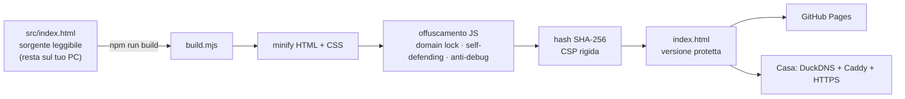

<div align="center">

```
██╗  ██╗██╗██████╗ ██╗██╗
██║ ██╔╝██║██╔══██╗██║██║
█████╔╝ ██║██████╔╝██║██║
██╔═██╗ ██║██╔══██╗██║██║
██║  ██╗██║██║  ██║██║███████╗
╚═╝  ╚═╝╚═╝╚═╝  ╚═╝╚═╝╚══════╝

```

# Kiril Buzylo — Software Developer & AI Builder

**Codice vero. Progetti online. *Costruiti prima dei diciott’anni.***

Il mio portfolio personale: un sito costruito interamente a mano, in un unico file HTML,<br>
senza framework e senza template, con animazioni cinematografiche e una build protetta.

<br>

[](https://kirix999.github.io/blogkiril/)
[](https://github.com/KiriX999)
[](https://t.me/kirilTrasher)


</div>

---

## 📑 Indice

- [Chi sono](#-chi-sono)
- [Cosa c’è dentro](#-cosa-cè-dentro)
- [Esperienza e animazioni](#-esperienza-e-animazioni)
- [Easter egg](#-easter-egg)
- [Stack e scelte tecniche](#-stack-e-scelte-tecniche)
- [Architettura](#-architettura)
- [Sicurezza e protezione del codice](#-sicurezza-e-protezione-del-codice)
- [Struttura del progetto](#-struttura-del-progetto)
- [Avvio rapido](#-avvio-rapido)
- [Deploy](#-deploy)
- [Personalizzazione](#-personalizzazione)
- [Performance e accessibilità](#-performance-e-accessibilità)
- [Privacy](#-privacy)
- [Roadmap](#-roadmap)
- [Licenza](#-licenza)

---

## 👋 Chi sono

Mi chiamo **Kiril Buzylo**, ho **17 anni** e studio **Informatica all’ENAIP di Varese** (terzo anno da settembre 2026).
Programmo ogni giorno: per me il codice è il modo più diretto di trasformare un’idea in qualcosa che funziona davvero.

| Progetto | Cos’è | Stack | Stato |
|---|---|---|---|
| 🧠 **KateZoora** | Piattaforma di chat con AI, ci lavoro da quasi due anni | Next.js 14 · TypeScript · Tailwind · Zustand · OpenRouter | 🟢 Live |
| 💬 **CaraTalk** | PWA di messaggistica usata ogni giorno: chiamate, vocali, storie | PWA · WebRTC · Firebase | 🟢 Live |
| 🏢 **BTP Softel** | Collaborazione: sito aziendale, app Android, siti clienti IT/EN/DE | Kotlin · MVVM · Web | 🔵 In produzione |
| 🕹️ **Questo sito** | Portfolio fatto a mano, con terminal e gioco pixel art | Vanilla JS · Canvas · Caddy | 🟢 Live |

> 🎯 **Cerco un tirocinio Erasmus** nello sviluppo software: un team vero, progetti reali, tanto da imparare.
> Scrivimi a **besenes8@gmail.com**.

---

## ✨ Cosa c’è dentro

| Sezione | Cosa fa |
|---|---|
| **Loader** | “ciao” scritto a mano e disegnato tratto per tratto, contatore 000 → 100 |
| **Hero** | Titolo gigante `SOFT⚡WARE / DEVE🤖LOPER / & AI BUILDER` con parallasse sul mouse e icone che fluttuano |
| **Manifesto** | Cornice con angoli luminosi, citazione mista sans/serif, firma scritta a mano |
| **Numeri** | Un pannello che **sale e si espande** a tutto schermo, statistiche animate, slide laterale, poi un **marquee gigante** con stella rotante |
| **Chi sono** | Testo che si rivela parola per parola con sfocatura, marquee di **loghi delle tecnologie** a colori |
| **Feature 01·02·03** | Un **cubo 3D** che viaggia da un lato all’altro dello schermo e ruota sulla faccia giusta mentre scorri |
| **Il metodo** | Frase fissa a schermo: le parole si accendono una dopo l’altra con lo scroll |
| **Progetti** | Slider fissato in stile *editorial*: striscia bianca a 3 colonne che scorre in direzioni opposte, sfondo sfocato colorato, contatore `PAGE 01 / 04` |
| **Servizi** | Bento asimmetrico con card a doppia cornice e luce che segue il mouse |
| **Percorso** | Timeline **orizzontale guidata dallo scroll verticale**, card alternate sopra/sotto, linea a gradiente |
| **GitHub live** | Repo, stelle, follower, linguaggi e **heatmap dell’attività** presi in tempo reale da `api.github.com` |
| **Lab** | Terminal interattivo + demo della chat di KateZoora |
| **Journal** | Articoli tecnici con lettore a schermo intero (deploy, WebRTC, AI streaming) |
| **Contatti** | CTA con **parola che ruota** (*di vero · di bello · di nuovo…*), form anti-spam, link diretti |
| **Footer** | Pillola con icone, menu **MORE** a comparsa e scritta gigante *KIRIL* |

**Extra:** orologio live di Varese, nav a isola con indicatore che scivola e dropdown, menu a schermo intero, tema **chiaro/scuro**, cursore personalizzato con etichette (`APRI`, `LEGGI`, `RUOTA`…), pulsanti magnetici, anello di progresso sul tasto “torna su”, linguetta *Disponibile per tirocinio*.

---

## 🎬 Esperienza e animazioni

Tutte le animazioni usano solo `transform` e `opacity` (GPU), curve `cubic-bezier(.32,.72,0,1)` e **un solo loop `requestAnimationFrame`** per tutto lo scroll.

```
scroll ─▶ rAF ─┬─▶ nav che si nasconde / ricompare
               ├─▶ anello di progresso
               ├─▶ parole del “metodo”
               ├─▶ pannello “numeri”  (sale → scorre → marquee)
               ├─▶ cubo 3D            (posizione + rotazione)
               ├─▶ slider progetti    (slide attiva)
               └─▶ timeline           (traslazione orizzontale)
```

I reveal usano `IntersectionObserver` (niente listener costosi), e su mobile le sezioni fissate diventano liste verticali pulite.

---

## 🥚 Easter egg

Apri il **terminal** nella sezione *Lab* e prova:

| Comando | Effetto |
|---|---|
| `help` | lista dei comandi |
| `whoami` · `projects` · `skills` | chi sono, i progetti, lo stack |
| `erasmus` · `contact` | cosa cerco, e ti porto al form |
| `github` | apre il mio profilo |
| `game` | 🎮 apre il **menu-gioco pixel art**: cammini per una città notturna ed entri nelle casette per aprire le sezioni |
| `matrix` | 🟢 pioggia di caratteri a schermo intero |
| `hack` · `sudo` | provaci 😏 |
| `↑` / `↓` / `Tab` | cronologia e autocompletamento |

Il gioco si apre anche dal pulsante 🎮 nella nav o dal menu.

---

## 🧰 Stack e scelte tecniche

- **HTML + CSS + JavaScript puro**: zero framework, zero dipendenze a runtime, un solo file.
- **Font**: Geist · Geist Mono · Instrument Serif · Great Vibes (Google Fonts).
- **Icone**: sprite SVG inline (linee sottili) + loghi da Simple Icons incorporati.
- **Dati live**: GitHub REST API con cache di 30 minuti in `sessionStorage`.
- **Build**: `javascript-obfuscator` + `html-minifier-terser`, solo in fase di build.
- **Hosting**: GitHub Pages + server di casa (DuckDNS + Caddy + HTTPS).

---

## 🏗 Architettura



---

## 🛡 Sicurezza e protezione del codice

> ⚠️ **Detto onestamente:** nessun sito web può nascondere al 100% il proprio codice. Tutto quello che il browser esegue può essere scaricato.
> L’obiettivo qui è un altro: rendere la copia **difficile**, **inutile su altri domini** e **perseguibile per legge**.

### Livello 1 — build protetta (`npm run build`)

| Protezione | Cosa fa |
|---|---|
| 🔒 **Offuscamento JS** | variabili rinominate, stringhe cifrate in base64 e spezzate, controllo del flusso “appiattito”: il codice diventa illeggibile |
| 🌐 **Domain lock** | il JavaScript gira **solo** su `kirix999.github.io`, sul dominio DuckDNS e in locale. Copiato altrove si blocca e **reindirizza all’originale** (testato) |
| 🧬 **Self-defending** | se qualcuno prova a riformattare o modificare il codice offuscato, smette di funzionare |
| 🐞 **Anti-debug** | aprendo i DevTools il debugger finisce in loop |
| 🗜 **Minify** | HTML e CSS compressi, commenti rimossi |

### Livello 2 — sicurezza del browser

| Protezione | Cosa fa |
|---|---|
| 🧱 **Content-Security-Policy rigida** | gli script sono ammessi solo se il loro **hash SHA-256** combacia: nessuno script iniettato può girare (niente `unsafe-inline` per gli script) |
| 🚫 **Zero handler inline** | nessun `onclick=""`: tutti gli eventi passano da listener delegati |
| 🖼 **Anti-clickjacking** | il sito non può essere incorporato in un iframe altrui: compare *“Contenuto protetto”* (testato) |
| 🧼 **Escape dell’input** | tutto ciò che scrive l’utente (chat, terminal) e i dati esterni (GitHub) passano da escape o `textContent` |
| 🔗 **`rel="noopener noreferrer"`** | su tutti i link esterni |
| 🛑 **`base-uri`, `object-src`, `form-action`, `frame-src`** | tutti su `'none'` |

### Livello 3 — deterrenti e diritti

| Protezione | Cosa fa |
|---|---|
| ©️ **Licenza proprietaria** | [LICENSE](LICENSE): *All Rights Reserved*, in italiano e inglese, legge 633/1941 |
| 📝 **Banner di copyright** | in testa all’HTML, nei meta tag e nel footer |
| 📋 **Attribuzione automatica** | chi copia un testo lungo si ritrova la firma *© Kiril Buzylo + link originale* |
| ⌨️ **Scorciatoie bloccate** | tasto destro, `F12`, `Ctrl+U`, `Ctrl+S`, `Ctrl+Shift+I/J/C` |
| 🤖 **No AI scraping** | `robots.txt` blocca GPTBot, CCBot, Google-Extended, ClaudeBot |
| 📮 **security.txt** | canale ufficiale per segnalare vulnerabilità ([RFC 9116](.well-known/security.txt)) |

### Livello 4 — server di casa (Caddy)

[`deploy/Caddyfile.example`](deploy/Caddyfile.example) aggiunge **header HTTP veri**, che GitHub Pages non permette:
`HSTS`, `frame-ancestors 'none'`, `X-Frame-Options`, `nosniff`, `Permissions-Policy`, `COOP`/`CORP`, blocco di `/src`, `/node_modules`, `.git` e rimozione dell’header `Server`.

### 🔑 La regola d’oro

**Il sorgente leggibile (`src/`) non va mai su GitHub.** GitHub Pages gratis richiede un repo pubblico, quindi ogni file pushato è visibile a tutti.
`src/` è già in `.gitignore`: tienine una copia sul PC o in un **repo privato** di backup, e pubblica solo `index.html`.

---

## 📁 Struttura del progetto

```
blogkiril/
├── src/
│   └── index.html            ← sorgente leggibile (NON pubblicare)
├── index.html                ← build protetta (questa va online)
├── build.mjs                 ← pipeline: minify → offusca → CSP → banner
├── serve.mjs                 ← server locale con header di sicurezza
├── package.json
├── deploy/
│   └── Caddyfile.example     ← hosting da casa con HTTPS + header
├── .well-known/
│   └── security.txt          ← segnalazione vulnerabilità
├── robots.txt · sitemap.xml
├── .nojekyll                 ← serve .well-known/ su GitHub Pages
├── LICENSE                   ← All Rights Reserved
└── README.md
```

---

## 🚀 Avvio rapido

> Serve **Node.js 18+**.

```bash
npm install          # installa gli strumenti di build (solo dev)
npm run dev          # http://localhost:5173/src/  → sorgente
npm run build        # crea index.html protetto
npm run preview      # build + server → http://localhost:5173/
```

Flusso di lavoro: **modifichi `src/index.html` → `npm run build` → pubblichi `index.html`.**
Non modificare mai `index.html` a mano: viene rigenerato a ogni build.

---

## 🌍 Deploy

<details>
<summary><b>GitHub Pages</b></summary>

1. `npm run build`
2. Fai commit e push di `index.html`, `robots.txt`, `sitemap.xml`, `.nojekyll`, `.well-known/`, `LICENSE`, `README.md`. **`src/` resta fuori grazie a `.gitignore`.**
3. Su GitHub apri **Settings → Pages → Deploy from branch → `main` / root**.
4. Il sito è online su `https://kirix999.github.io/blogkiril/`.

</details>

<details>
<summary><b>Server di casa (DuckDNS + Caddy)</b></summary>

1. Crea un sottodominio su [duckdns.org](https://www.duckdns.org) e imposta l’aggiornamento automatico dell’IP.
2. Sul router apri **solo** le porte **80** e **443** verso il PC.
3. Copia `deploy/Caddyfile.example` in `/etc/caddy/Caddyfile` e cambia dominio e cartella.
4. Copia in `/var/www/portfolio` **solo** i file pubblici (`index.html`, `robots.txt`, `sitemap.xml`, `.well-known/`).
5. `sudo systemctl reload caddy`: l’HTTPS arriva da solo con Let’s Encrypt.
6. In `build.mjs` sostituisci `'.duckdns.org'` con il tuo dominio preciso (es. `'kiril.duckdns.org'`) e rifai la build.

</details>

---

## 🎛 Personalizzazione

Tutto in `src/index.html`:

| Cosa | Dove |
|---|---|
| Progetti dello slider | array `PROJECTS` (+ mockup in `MOCK`) |
| Articoli del Journal | array `POSTS` |
| Utente GitHub per i dati live | costante `USER` nel blocco *GITHUB LIVE* |
| Comandi del terminal | oggetto `cmds` nel blocco *TERMINAL* |
| Risposte della chat demo | oggetto `demoR` |
| URL per le notifiche Telegram | `ANALYTICS_URL` (lato server, **mai** il secret nel frontend) |
| Colori e font | variabili CSS in `:root` |
| Domini autorizzati | `CONFIG.domains` in `build.mjs` |

---

## ⚡ Performance e accessibilità

- Animazioni solo con `transform` / `opacity`, un solo loop `requestAnimationFrame` per lo scroll.
- `IntersectionObserver` per reveal, contatori e caricamento lazy dei dati GitHub.
- `backdrop-filter` solo su elementi fissi (nav, menu, overlay).
- **`prefers-reduced-motion`** rispettato: niente animazioni pesanti per chi le disattiva.
- HTML semantico, `aria-*` su menu, dialog e FAQ, focus gestito nel lettore articoli, `Esc` chiude tutto.
- Layout responsive: sotto i 900px le sezioni fissate diventano liste verticali.

---

## 🍪 Privacy

Cookie tecnici e raccolta dei dati di visita **solo dopo il consenso esplicito** (GDPR, Reg. UE 2016/679).
Nessun tracker pubblicitario. Servizi terzi: Google Fonts e le API pubbliche di GitHub.
Dettagli completi nella sezione *Privacy* del sito.

---

## 🗺 Roadmap

- [x] Redesign completo in stile editorial / cinematic
- [x] Build protetta (offuscamento, domain lock, CSP con hash)
- [x] Dati GitHub live e Journal
- [x] Tema chiaro / scuro
- [ ] Versione inglese (IT / EN)
- [ ] Screenshot reali dei progetti al posto dei mockup
- [ ] Altri articoli nel Journal

---

## ©️ Licenza

**© 2026 Kiril Buzylo. Tutti i diritti riservati.**
Il codice è pubblicato **solo per essere visto**, non per essere riusato. Vedi [LICENSE](LICENSE).
Per collaborazioni o permessi: **besenes8@gmail.com**

<div align="center">

<br>

**Fatto a mano a Varese, riga per riga.** 🇮🇹

[](mailto:besenes8@gmail.com)

</div>
